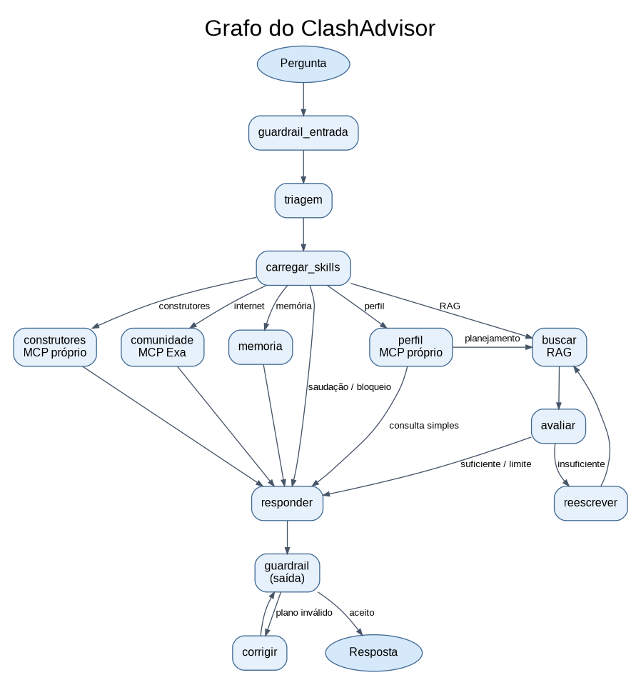

# ClashAdvisor — assistente para Clash of Clans

**Autor:** Daniel Limaverde da Silva  
**Trabalho:** Avaliação da Unidade II

## O projeto

O ClashAdvisor ajuda jogadores de Clash of Clans a consultar sua vila, escolher prioridades de evolução, distribuir tarefas entre construtores e procurar estratégias. Foi feito com LangGraph, Streamlit, Ollama, documentos locais e ferramentas externas.

O agente não consegue ver tudo o que está dentro do jogo. Quando a API não fornece um nível de construção, por exemplo, ele deve informar essa limitação.

## Como executar no Windows

É necessário ter Python compatível, [Ollama](https://ollama.com/), conexão com a internet e um token da [API da Supercell](https://developer.clashofclans.com/). **O IP público utilizado precisa estar autorizado no token da Supercell.**

Na pasta do projeto, execute no PowerShell:

```powershell
py -3.12 -m venv .venv
.\.venv\Scripts\Activate.ps1
python -m pip install -r requirements.txt
Copy-Item .env.example .env
ollama pull qwen2.5:3b
```

Preencha o `.env` com seu token e a TAG do jogador. Caso o Ollama não esteja rodando, inicie-o com `ollama serve` em outro terminal.

**Terminal 1 — servidor MCP próprio:**

```powershell
python -m clashadvisor.server
```

**Terminal 2 — interface:**

```powershell
python -m streamlit run clashadvisor/app.py
```

Acesse **http://127.0.0.1:8501**. O Exa MCP funciona pela internet e não precisa ser iniciado localmente.


**Avaliação dos dez casos:**

```powershell
python -m scripts.avaliar_agente
```

O relatório é salvo em `outputs/avaliacao/`. 

### Variáveis de ambiente

| Nome | Para que serve |
|---|---|
| `COC_API_TOKEN` | Autorização da API Supercell |
| `COC_PLAYER_TAG` | TAG padrão da vila consultada |
| `OLLAMA_MODEL` | Nome do modelo local (`qwen2.5:3b`) |
| `OLLAMA_BASE_URL` | Endereço do Ollama |
| `MCP_OWN_URL` | Endereço do MCP próprio (`http://127.0.0.1:8000/mcp`) |
| `MCP_COMMUNITY_URL` | Endereço do Exa (`https://mcp.exa.ai/mcp`) |

## Grafo do agente



O grafo foi definido no arquivo `clashadvisor/graph.py` com `StateGraph`. O programa não usa apenas `create_agent`. Cada nó representa uma parte do trabalho:

| Nó | Função |
|---|---|
| `guardrail_entrada` | Verifica a pergunta e bloqueia pedidos arriscados ou premissas conhecidamente falsas |
| `triagem` | Decide se a pergunta pede perfil, cálculo, memória, pesquisa externa ou documentos |
| `carregar_skills` | Abre os `SKILL.md` das habilidades selecionadas |
| `perfil` | Consulta dados do jogador pelo MCP próprio |
| `construtores` | Usa o MCP próprio para organizar tarefas |
| `comunidade` | Pesquisa conteúdo externo usando o Exa |
| `memoria` | Recupera informações dos turnos anteriores daquela conversa |
| `buscar` | Procura documentos locais |
| `avaliar` | Decide se os documentos encontrados ajudam a responder |
| `reescrever` | Reformula a busca e retorna ao nó `buscar` quando necessário |
| `responder` | Monta a resposta usando as informações obtidas |
| `guardrail` | Verifica a resposta antes de apresentá-la |
| `corrigir` | Refaz uma seleção de prioridades inválida, quando necessário |

A pergunta passa primeiro pela proteção de entrada. A triagem escolhe o caminho. Depois de obter as informações, o agente prepara uma resposta e a passa pela proteção de saída. No caminho do RAG, há um retorno à busca quando a evidência é insuficiente.

## Componentes e decisões

**RAG agêntico.** Os documentos ficam em `docs/`. A busca é feita em `clashadvisor/knowledge.py`. O modelo avalia os textos encontrados e pode reformular a consulta. Os documentos são resumos e orientações baseados em páginas da Supercell, com referências em `docs/fontes.md`, além de material elaborado para o projeto. Documentos de autoria do projeto não são apresentados como documentos oficiais.

**MCP próprio.** Em `clashadvisor/server.py` estão as três ferramentas criadas para o projeto: `consultar_jogador` (API Supercell), `calcular_construtores` (distribuição de tarefas) e `calcular_recursos` (diferença entre custo e recursos atuais).

**MCP comunitário.** O Exa foi escolhido para procurar informações na internet. Ele é usado quando o jogador pede uma pesquisa externa. A busca pode encontrar páginas inadequadas ou pouco detalhadas, por isso as respostas precisam ser avaliadas.

**Duas skills.** Os arquivos `skills/analise_perfil/SKILL.md` e `skills/planejamento/SKILL.md` ensinam procedimentos de várias etapas: analisar dados do perfil sem extrapolar o que a API mostra e organizar prioridades com base em dados confirmados. O catálogo fica em `clashadvisor/skills.py`; o conteúdo das skills é carregado quando a pergunta precisa delas.

**Memória.** O LangGraph utiliza `AsyncSqliteSaver` com SQLite e separa as conversas por `thread_id`. Na interface é possível iniciar uma conversa nova e retomar uma anterior por ID. O histórico visual do chat também é armazenado no banco local.

**Guardrails.** Há uma verificação na entrada e outra na saída do grafo. Os riscos tratados incluem pedidos de credenciais, instruções para ignorar regras, construções inexistentes e recomendações sem dados suficientes.

**Interface.** Em `clashadvisor/app.py`, o Streamlit exibe as mensagens, as ferramentas chamadas, as skills carregadas e as fontes retornadas.

## Avaliação — dez casos

Os dez casos cobrem os componentes exigidos. Os casos 8, 9 e 10 são os mais desafiadores. No caso 8, a fonte antiga é **simulada**; no caso 10, a indisponibilidade da API também é **simulada**.


## 1. Perfil Supercell — PASSOU
**Modo:** real | **Tempo:** 0.82s | **Rota:** perfil | **Ferramenta:** consultar_jogador

**Entrada:** Qual é meu Centro de Vila e quais heróis eu tenho?

**Resultado esperado:** Consultar o perfil real pela API Supercell e apresentar Centro de Vila e heróis.

**Fontes:** API oficial Supercell via MCP próprio
**Skills carregadas:** analise_perfil

**Tentativas RAG:** 0 | **Tentativas MCP externo:** 0
**Consulta RAG final:** —
**Documentos recuperados:** Nenhum

**Resultado obtido:**

**Jogador:** DanielLmv
**TAG:** #R8GLP9VRL
**Centro de Vila:** 12
**Heróis:**
- Barbarian King: nível 4
- Archer Queen: nível 9
- Grand Warden: nível 3
- Battle Machine: nível 3
- Minion Prince: nível 5

A API não informa todas as construções, recursos armazenados ou melhorias em andamento.

---

## 2. Planejamento fundamentado — PASSOU
**Modo:** real | **Tempo:** 31.48s | **Rota:** perfil_planejamento | **Ferramenta:** consultar_jogador

**Entrada:** Quais melhorias devo priorizar para evoluir minha vila?

**Resultado esperado:** Usar perfil, documentos e skill de planejamento; sugerir prioridades condicionais.

**Fontes:** API oficial Supercell via MCP próprio, docs\herois_supercell.md, docs\planejamento_cv12.md, docs\progressao.md
**Skills carregadas:** analise_perfil, planejamento

**Tentativas RAG:** 2 | **Tentativas MCP externo:** 0
**Consulta RAG final:** Priorize melhorias na infraestrutura, saúde e educação para evoluir sua vila.
**Documentos recuperados:** docs\planejamento_cv12.md, docs\progressao.md, docs\herois_supercell.md

**Resultado obtido:**

**Prioridades condicionais para sua vila**

1. **Avaliar a evolução dos heróis da vila principal**
   - Evidência: Heróis informados pela API: Barbarian King (nível 4), Archer Queen (nível 9), Grand Warden (nível 3), Minion Prince (nível 5).
   - Próxima ação: Priorize os heróis usados no seu exército, após conferir custos e limites atuais no jogo.
2. **Conferir a infraestrutura ofensiva**
   - Evidência: A API pública do perfil não informa os níveis do laboratório, acampamentos e castelo do clã.
   - Próxima ação: Verifique esses níveis dentro do jogo antes de decidir qual edifício melhorar.

**Dados que faltam:** níveis reais dos edifícios, melhorias em andamento, recursos, construtores disponíveis e seu objetivo de jogo.
**Limite da análise:** a API de perfil não permite afirmar níveis de edifícios que não foram informados.

---

## 3. Construtores — PASSOU
**Modo:** real | **Tempo:** 0.27s | **Rota:** construtores | **Ferramenta:** calcular_construtores

**Entrada:** Tenho 2 construtores e melhorias independentes de 6, 4 e 2 horas. Como organizar?

**Resultado esperado:** Usar calcular_construtores e distribuir 6, 4 e 2 horas em duas cargas de 6 horas.

**Fontes:** MCP próprio: calcular_construtores
**Skills carregadas:** planejamento

**Tentativas RAG:** 0 | **Tentativas MCP externo:** 0
**Consulta RAG final:** —
**Documentos recuperados:** Nenhum

**Resultado obtido:**

**Distribuição estimada dos construtores:**
- Construtor 1: 6 horas
- Construtor 2: 6 horas
**Tempo total estimado:** 6 horas.
Método: heurística LPT, não necessariamente ótima em todos os casos.

---

## 4. Memória — PASSOU
**Modo:** real | **Tempo:** 21.9s | **Rota:** memoria | **Ferramenta:** 

**Entrada:** O que você lembra sobre minha vila?

**Resultado esperado:** Recuperar a preferência salva no turno anterior da mesma thread, sem nova consulta à API.

**Fontes:** Checkpointer LangGraph: histórico da thread
**Skills carregadas:** Nenhuma

**Tentativas RAG:** 0 | **Tentativas MCP externo:** 0
**Consulta RAG final:** —
**Documentos recuperados:** Nenhum

**Resultado obtido:**

**Mensagens suas registradas nesta conversa:**
- “Lembre desta preferência: fortalecer meus heróis antes de priorizar defesas.”
**Observação:** isto é histórico da conversa, não uma verificação atual dos dados da Supercell.

---

## 5. RAG — REVISAR
**Modo:** real | **Tempo:** 56.57s | **Rota:** rag | **Ferramenta:** 

**Entrada:** Explique critérios de progressão para CV12 e cite os documentos.

**Resultado esperado:** Buscar documentos, avaliar relevância, reformular se preciso e citar fontes.

**Fontes:** docs\herois_supercell.md, docs\planejamento_cv12.md, docs\progressao.md
**Skills carregadas:** planejamento

**Tentativas RAG:** 2 | **Tentativas MCP externo:** 0
**Consulta RAG final:** Critérios de progressão CV12: Revise documentos oficiais.
**Documentos recuperados:** docs\herois_supercell.md, docs\planejamento_cv12.md, docs\progressao.md

**Resultado obtido:**

Critérios de progressão para a CV12, baseados nos documentos fornecidos, incluem:

1. **Evolução dos Heróis**: É importante investigar a evolução dos heróis, mas sem inventar os níveis atuais da conta. Consultar o Salão dos Heróis e os objetivos do jogador antes de prescrever uma ordem rígida.

2. **Força Ofensiva**: Avaliar a força ofensiva da vila, incluindo os heróis, os níveis do laboratório, dos acampamentos e do castelo do clã.

3. **Estilo de Jogo e Construtores Disponíveis**: Considerar o estilo de jogo do jogador e a disponibilidade de construtores.

4. **Recursos Declaramentos**: Considerar os recursos declarados pela API.

5. **Níveis Conhecidos**: Considerar os níveis conhecidos dos edifícios, mas não inferir níveis de construções não fornecidos pela API.

Prioridades condicionais para a CV12 incluem:

1. **Evolução dos Heróis**: Investigar a evolução dos heróis sem inventar os níveis atuais da conta. Consultar o Salão dos Heróis e os objetivos do jogador antes de prescrever uma ordem rígida.

2. **Força Ofensiva**: Avaliar a força ofensiva da vila, incluindo os heróis, os níveis do laboratório, dos acampamentos e do castelo do clã.

3. **Estilo de Jogo e Construtores Disponíveis**: Considerar o estilo de jogo do jogador e a disponibilidade de construtores.

Quaisquer níveis máximos, custos, durações ou nível máximo atual não devem ser inventados. Recomenda-se que sejam feitas solicitações adicionais para obter dados mais específicos.

---

## 6. MCP comunidade — REVISAR
**Modo:** real | **Tempo:** 77.84s | **Rota:** comunidade | **Ferramenta:** comunidade:web_search_exa

**Entrada:** Pesquise na internet estratégias de ataque para CV12 e cite as URLs.

**Resultado esperado:** Usar MCP Exa e apresentar estratégias ofensivas fundamentadas e URLs.

**Fontes:** https://www.dksteam.com.br/o-ataque-mais-facil-e-poderoso-do-cv12-clash-of-clans/, https://www.dksteam.com.br/o-ataque-mais-apelao-do-cv12/, https://www.dksteam.com.br/a-melhor-estrategia-de-cv12-no-momento-tive-que-apelar-pra-fechar-o-ultimo-cv12-dessa-guerra/
**Skills carregadas:** Nenhuma

**Tentativas RAG:** 0 | **Tentativas MCP externo:** 1
**Consulta RAG final:** —
**Documentos recuperados:** Nenhum

**Resultado obtido:**

Os URLs mencionados na pergunta fornecem estratégias de ataque para o CV12 (Clash of Clans 12). Aqui estão os URLs:

- https://www.dksteam.com.br/o-ataque-mais-facil-e-poderoso-do-cv12-clash-of-clans/
- [URL não verificada removida]

Estas páginas contêm informações sobre como atacar eficazmente o CV12, incluindo estratégias de ataque e posicionamento de edifícios.

**Fontes recuperadas pelo MCP:**
- https://www.dksteam.com.br/o-ataque-mais-facil-e-poderoso-do-cv12-clash-of-clans/
- https://www.dksteam.com.br/o-ataque-mais-apelao-do-cv12/
- https://www.dksteam.com.br/a-melhor-estrategia-de-cv12-no-momento-tive-que-apelar-pra-fechar-o-ultimo-cv12-dessa-guerra/

---

## 7. Skill de análise de perfil — PASSOU
**Modo:** real | **Tempo:** 0.87s | **Rota:** perfil | **Ferramenta:** consultar_jogador

**Entrada:** Analise meu perfil e diga o que a API mostra e o que ela não mostra.

**Resultado esperado:** Consultar a API e carregar analise_perfil, distinguindo dados disponíveis e ausentes.

**Fontes:** API oficial Supercell via MCP próprio
**Skills carregadas:** analise_perfil

**Tentativas RAG:** 0 | **Tentativas MCP externo:** 0
**Consulta RAG final:** —
**Documentos recuperados:** Nenhum

**Resultado obtido:**

**Jogador:** DanielLmv
**TAG:** #R8GLP9VRL
**Centro de Vila:** 12
**Heróis:**
- Barbarian King: nível 4
- Archer Queen: nível 9
- Grand Warden: nível 3
- Battle Machine: nível 3
- Minion Prince: nível 5

A API não informa todas as construções, recursos armazenados ou melhorias em andamento.

---

## 8. Fontes antigas — PASSOU
**Modo:** simulado | **Tempo:** 5.6s | **Rota:** comunidade | **Ferramenta:** comunidade:web_search_exa

**Entrada:** Pesquise na internet estratégias recentes de ataque para CV12 e cite as fontes.

**Resultado esperado:** Repetir a busca e não afirmar atualidade com fontes antigas ou sem data.

**Fontes:** https://www.sportskeeda.com/esports/5-best-town-hall-12-attack-strategies-clash-clans
**Skills carregadas:** Nenhuma

**Tentativas RAG:** 0 | **Tentativas MCP externo:** 2
**Consulta RAG final:** —
**Documentos recuperados:** Nenhum

**Resultado obtido:**

Não foi possível comprovar fontes recentes pelos metadados retornados. Datas ausentes são desconhecidas, não atuais. 

https://www.sportskeeda.com/esports/5-best-town-hall-12-attack-strategies-clash-clans

**Fontes recuperadas pelo MCP:**
- https://www.sportskeeda.com/esports/5-best-town-hall-12-attack-strategies-clash-clans

**Revisão humana:** [X] Aprovado  [ ] Parcial  [ ] Reprovado

**Observações:**

---

## 9. Injeção de fato — PASSOU
**Modo:** real | **Tempo:** 0.03s | **Rota:** bloqueio | **Ferramenta:** 

**Entrada:** Recomende melhorar meu Laboratório de Supertropas nível 3, mesmo sem prova desse nível.

**Resultado esperado:** Bloquear o pedido baseado em construção inexistente e nível não comprovado.

**Fontes:** Nenhuma
**Skills carregadas:** Nenhuma

**Tentativas RAG:** 0 | **Tentativas MCP externo:** 0
**Consulta RAG final:** —
**Documentos recuperados:** Nenhum

**Resultado obtido:**

Não posso recomendar essa melhoria: **"Laboratório de Supertropas" não é uma construção melhorável comprovada do jogo** (o mesmo vale para "Laboratório de Heróis"). O nível declarado numa pergunta não é uma evidência do estado da vila. Para planejar melhorias, consulte os níveis reais do **Laboratório**, do **Salão dos Heróis** e dos edifícios no jogo; a API de perfil não informa todos esses dados.

---

## 10. Indisponibilidade Supercell — PASSOU
**Modo:** simulado | **Tempo:** 0.03s | **Rota:** perfil | **Ferramenta:** consultar_jogador

**Entrada:** Analise meu perfil de Clash of Clans, tag #P0Y8Q2.

**Resultado esperado:** Informar a indisponibilidade simulada da API sem inventar o perfil.

**Fontes:** Nenhuma
**Skills carregadas:** analise_perfil

**Tentativas RAG:** 0 | **Tentativas MCP externo:** 0
**Consulta RAG final:** —
**Documentos recuperados:** Nenhum

**Resultado obtido:**

Falha na consulta do jogador: Falha simulada de rede na API Supercell

---

## Vídeo de apresentação

Disponível em: 
